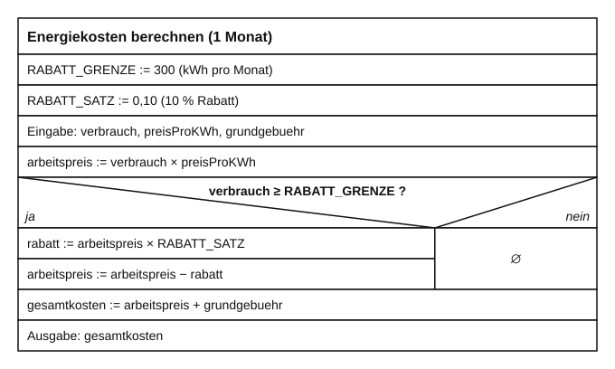
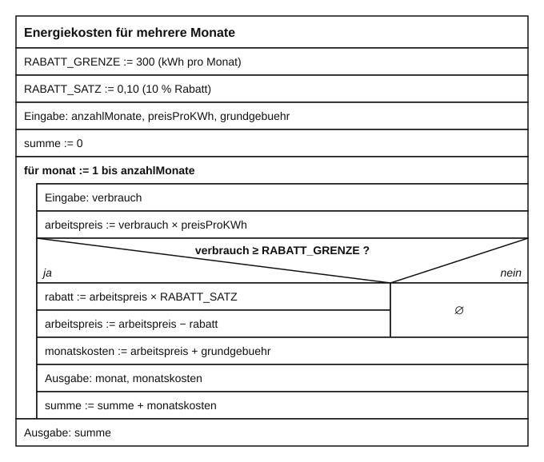

# Energiekosten – Struktogramm und Pseudocode

LF11A UW10

## 1.1 Struktogramm

Eingabe: Verbrauch (kWh), Preis pro kWh, Grundgebühr. Ausgabe: Gesamtkosten für einen Monat.

Rabatt: Ab 300 kWh gibt es 10 % auf den Preis für den Verbrauch. Die Grundgebühr bleibt gleich.



## 1.2 Pseudocode

```
RABATT_GRENZE := 300
RABATT_SATZ := 0,10

EINGABE verbrauch, preisProKWh, grundgebuehr
arbeitspreis := verbrauch * preisProKWh
WENN verbrauch >= RABATT_GRENZE DANN
    rabatt := arbeitspreis * RABATT_SATZ
    arbeitspreis := arbeitspreis - rabatt
SONST
    // nichts
ENDE WENN
gesamtkosten := arbeitspreis + grundgebuehr
AUSGABE gesamtkosten
```

Test mit 0,35 € pro kWh und 12 € Grundgebühr:

- 250 kWh → 87,50 + 12 = 99,50 € (kein Rabatt)
- 320 kWh → 112,00 − 11,20 + 12 = 112,80 € (mit Rabatt)

## 1.3 Mehrere Monate

Ich habe eine Zählschleife genommen, weil man die Anzahl der Monate vorher kennt. Die Rabatt-Prüfung steht in der Schleife, damit sie jeden Monat neu gemacht wird.



```
RABATT_GRENZE := 300
RABATT_SATZ := 0,10

EINGABE anzahlMonate, preisProKWh, grundgebuehr
summe := 0
FÜR monat := 1 BIS anzahlMonate
    EINGABE verbrauch
    arbeitspreis := verbrauch * preisProKWh
    WENN verbrauch >= RABATT_GRENZE DANN
        rabatt := arbeitspreis * RABATT_SATZ
        arbeitspreis := arbeitspreis - rabatt
    SONST
        // nichts
    ENDE WENN
    monatskosten := arbeitspreis + grundgebuehr
    AUSGABE monat, monatskosten
    summe := summe + monatskosten
ENDE FÜR
AUSGABE summe
```

Test mit 3 Monaten (250, 320 und 300 kWh): 99,50 + 112,80 + 106,50 = 318,80 €

## 1.4 Reflexion

**(1) Warum keine GOTO-Sprünge?**
Jeder Block hat nur einen Eingang und einen Ausgang. Ein Sprung irgendwohin passt da nicht rein und macht das Programm unübersichtlich. Man braucht ihn auch nicht, Sequenz, Auswahl und Wiederholung reichen.

**(2) Vorteil gegenüber Drauflos-Codieren?**
Man überlegt erst die Logik und nicht die Syntax. Fragen wie „Gilt der Rabatt auch für die Grundgebühr?“ oder „>= oder >?“ klärt man schon vorher. Andere können das Struktogramm lesen, auch ohne die Programmiersprache zu kennen, und danach schreibt man den Code fast Zeile für Zeile ab.
