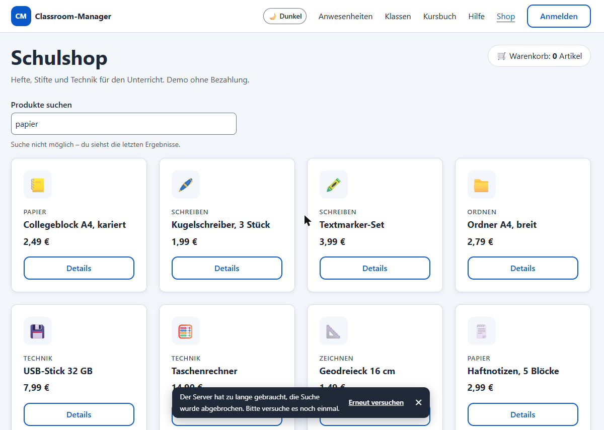

# Mini-Shop: Suche mit Debounce und Abbruch

LF10a UW7 – Asynchrone JS-Muster

Start wie in UW6: `npm run api` im Ordner `frontend/prototypes/mini-shop`, dann `index.html` mit Live Server öffnen.

## 1.1 Planung

1. Suchfeld über der Liste einbauen.
2. Bei jeder Eingabe nicht sofort suchen, sondern erst, wenn 300 ms keine Taste mehr gedrückt wurde (Debounce, `js/debounce.js`).
3. Dann `GET /products?q=…` an den JSON Server schicken und die Treffer anzeigen.
4. Kommt eine neue Suche, die alte Anfrage abbrechen.
5. Bei Fehlern einen Toast zeigen.

Ergebnis: Wenn ich „papier“ tippe, geht nur eine Anfrage raus und nicht sechs.

## 1.2 AbortController

Vor jeder neuen Suche ruft `loadProducts()` `abort()` für die alte Anfrage auf. So kann eine langsame alte Antwort nicht nach der neuen ankommen und die richtigen Treffer überschreiben.

Den Abbruch durch neue Eingabe (`AbortError`) zeige ich nicht als Fehler an, die neue Suche läuft ja schon. Getestet: „papier“ eingeben, nach 0,7 s auf „technik“ ändern. Im Server-Log hat die Anfrage `?q=papier` keine Antwort, auf der Seite erscheinen nur die Technik-Produkte.

## 1.3 und 1.4 Toast

Geht eine Suche schief, bleibt die letzte Liste stehen und unten erscheint ein Toast mit „Erneut versuchen“. Er verschwindet nach 6 Sekunden oder mit ✕. Mit `role="alert"` liest ein Screenreader ihn vor.

Abbruch nach 5 Sekunden ohne Antwort (`AbortSignal.timeout`): „Der Server hat zu lange gebraucht, die Suche wurde abgebrochen.“ Zum Testen bricht `index.html?test=timeout` die Suche schon nach 300 ms ab.

Woran erkenne ich, dass es gelöst ist? Beim schnellen Tippen geht nur eine Anfrage raus (DevTools → Network), alte Anfragen stehen dort als „canceled“, und bei einem Fehler bleibt die Seite benutzbar und sagt verständlich, was los ist.
