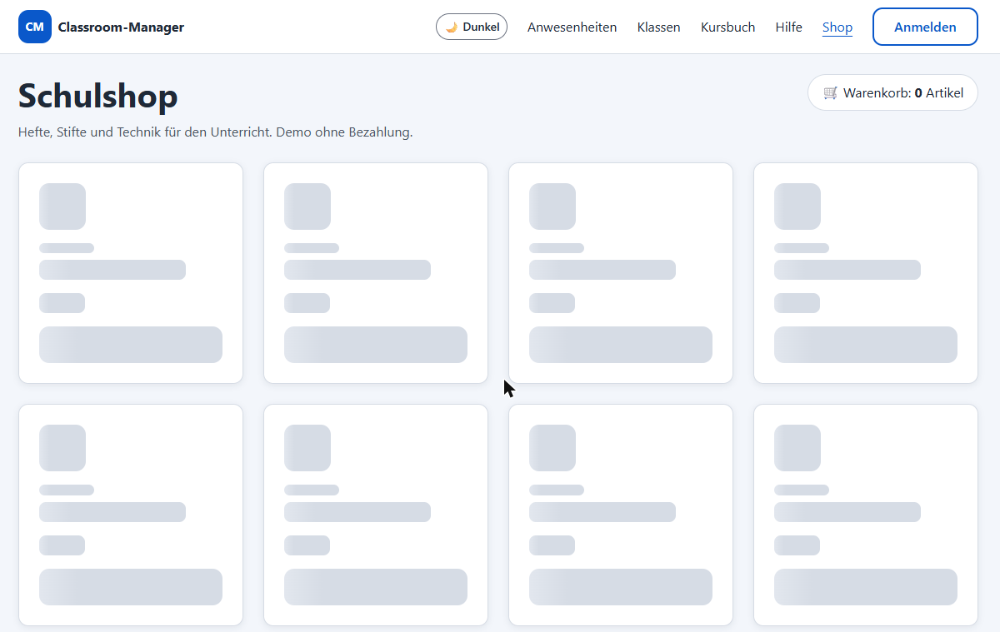
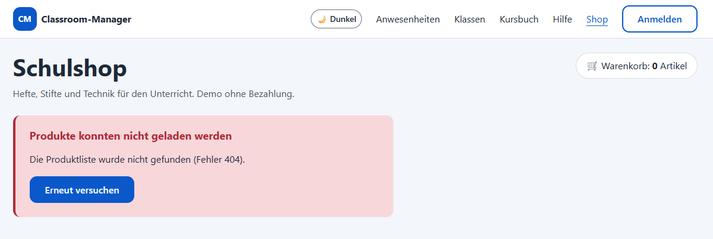

# Mini-Shop: Produkte per REST laden

LF10a UW6 – HTTP, REST, JSON

Die Produkte stehen jetzt nicht mehr im JavaScript, sondern in `db.json`. Der JSON Server liefert sie als REST-API aus.

Starten:

1. Im Ordner `frontend/prototypes/mini-shop`: `npm run api` (JSON Server auf Port 3001, mit 800 ms Verzögerung, damit man das Laden sieht)
2. `index.html` mit Live Server öffnen

## 1.1 Planung

1. Produktdaten in `db.json` verschieben und JSON Server starten. `GET http://localhost:3001/products` liefert dann alle Produkte als JSON.
2. Im JavaScript mit `fetch()` anfragen und mit `await` auf die Antwort warten.
3. Prüfen, ob die Antwort ok ist (Status 200–299), dann mit `response.json()` in ein Array umwandeln.
4. Für jedes Produkt eine Karte erzeugen und in die Liste einfügen.
5. Während des Wartens Platzhalter zeigen, bei einem Fehler eine Meldung.

In den DevTools unter Network sieht man die Anfrage `products` mit Status 200 und die Antwort als JSON.

## 1.2 Fehlerfälle

`fetch()` meldet bei 404 oder 500 keinen Fehler, weil ja eine Antwort angekommen ist. Deshalb prüfe ich `response.ok` selbst. Die Meldungen:

- 404: „Die Produktliste wurde nicht gefunden (Fehler 404).“
- 500 und höher: „Der Server hat gerade ein Problem …“
- Server aus: „Der Server ist nicht erreichbar …“
- keine Antwort nach 5 Sekunden: „Der Server antwortet zu langsam …“ (Abbruch mit `AbortController`)

Jede Meldung hat einen Button „Erneut versuchen“. Mit `role="alert"` liest ein Screenreader sie sofort vor.

## 1.3 Ladezustand (Skeleton)

Solange die Daten laden, sieht man 8 graue Karten mit einem hellen Streifen. Sie sind genauso hoch wie die echten Karten, deshalb springt nichts, wenn die Produkte kommen. Für Screenreader gibt es den Text „Produkte werden geladen …“.

Woran erkenne ich, dass es gelöst ist? Beim Neuladen kommen erst die grauen Karten und nach knapp einer Sekunde die Produkte an derselben Stelle. Mit Network → „Slow 4G“ sieht man das noch deutlicher.

## 1.4 Fehler simulieren

Mit `index.html?test=404` fragt die Seite die Adresse `/gibt-es-nicht` an. Der JSON Server antwortet mit 404, und die Seite zeigt die Meldung. Den Fall „Server nicht erreichbar“ habe ich getestet, indem ich den JSON Server gestoppt habe.

