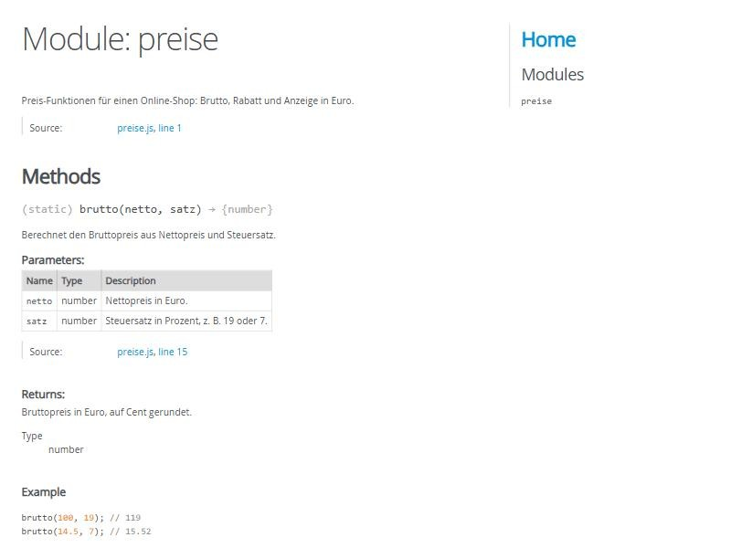

# Kommentargesteuertes Programmieren mit JSDoc

LF11a UW11

Code: `frontend/prototypes/preisrechner/` (`npm install`, `npm run docs`)

## 1.1 Kommentare bewerten

a) `// Zahl um 1 erhöhen` über `zaehler++;` ist unnötig. Er sagt nur noch einmal, was im Code sowieso steht.

Der Kommentar über `brutto(netto, satz)` ist sinnvoll, weil er sagt, wofür die Funktion da ist, ohne dass man den Code lesen muss. Es fehlt aber, wie `satz` gemeint ist (19 oder 0.19?) und was zurückkommt.

b) Regel: Ein Kommentar erklärt, wofür etwas da ist oder warum es so gemacht wurde, nicht was der Code Zeile für Zeile macht.

## 1.2 Tags zuordnen

| Tag | Bedeutung | Mein Eintrag für brutto() |
|---|---|---|
| @param | beschreibt einen Parameter mit Typ | `@param {number} netto - Nettopreis in Euro.` und `@param {number} satz - Steuersatz in Prozent, z. B. 19 oder 7.` |
| @returns | beschreibt den Rückgabewert mit Typ | `@returns {number} Bruttopreis in Euro, auf Cent gerundet.` |
| @example | zeigt einen Aufruf mit Ergebnis | `brutto(100, 19); // 119` |

## 1.3 Modul dokumentieren und Doku erzeugen

a) Modul `src/preise.js` mit vier Funktionen: `brutto`, `rabatt`, `runden`, `formatEuro`. Jede hat Beschreibung, `@param`, `@returns` und `@example`, `rabatt` zusätzlich `@throws` (Fehler bei Rabatt unter 0 oder über 100). Die Beispiele habe ich mit Node ausprobiert, die Ergebnisse stimmen.

b) `npm install --save-dev jsdoc`, dann `npx jsdoc src -d docs`. Die Startseite `index.html` war dabei fast leer, da stand nur ein Link auf das Modul. Deshalb gebe ich noch eine `README.md` mit (`jsdoc src README.md -d docs`, als `npm run docs` gespeichert). Den Ordner `docs/` habe ich nicht committet, weil er jederzeit neu erzeugt werden kann.

c) In der Doku erscheinen alle vier Funktionen mit Parametern, Typen, Rückgabewert und Beispiel.

## 1.4 Dokumentation prüfen

Ich habe alleine gearbeitet und die Prüfliste deshalb auf meine eigene Doku angewendet.

| Prüffrage | Ja / Nein | Hinweis |
|---|---|---|
| Versteht man jede Funktion ohne den Code zu lesen? | Ja | jede Funktion hat einen Satz, wofür sie da ist |
| Sind alle Parameter mit Typ beschrieben? | Ja | alle `number`, mit Einheit (Euro, Prozent) |
| Gibt es mindestens ein Beispiel? | Ja | bei jeder Funktion eins |

## 1.5 Reflexion

a) Die Doku steht direkt über der Funktion. Wer die Funktion ändert, sieht den Kommentar sofort und passt ihn mit an. Die HTML-Seite wird danach per Befehl neu erzeugt. Ein separates Word-Dokument vergisst man dagegen schnell.

b) Nachteil: Niemand prüft automatisch, ob der Kommentar noch stimmt. Ändert man den Code und nicht den Kommentar, ist die Doku trotzdem falsch. Außerdem werden die Dateien länger.
