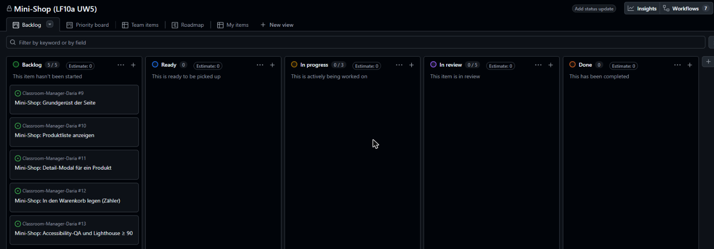
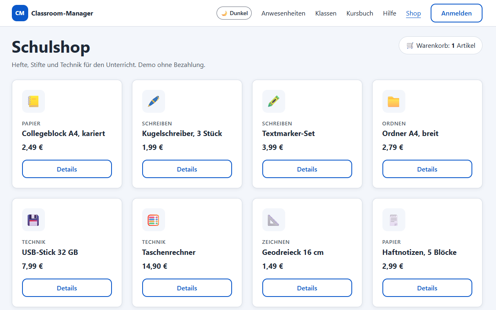
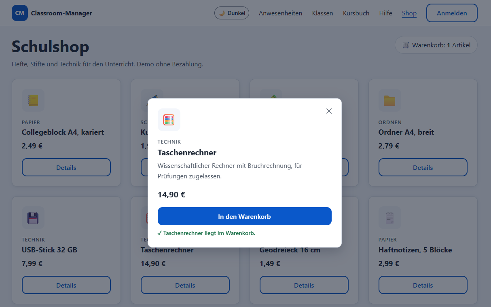

# Projekt 1: Mini-Shop-UI

LF10a UW5 – klickbarer Schulshop ohne Backend (Hefte, Stifte, Technik).

Code: `frontend/prototypes/mini-shop/` · Start: `index.html` mit Live Server öffnen (wegen `type="module"` nicht per Doppelklick).

## 1.1 Planung: Backlog mit 5 Tickets

So bin ich vorgegangen:

1. Ziel klären: Was soll die Kundendemo zeigen? → Liste und Details, ohne Bezahlung.
2. User Stories schreiben: „Als Kundin möchte ich …, damit …“.
3. In kleine Tickets teilen: jedes Ticket ist in kurzer Zeit fertig und wird ein Commit.
4. Für jedes Ticket „Fertig, wenn …“ festlegen (Akzeptanzkriterien), damit man prüfen kann, ob es erledigt ist.
5. Reihenfolge festlegen: Grundgerüst zuerst, Prüfung am Ende.
6. Tickets als GitHub Issues anlegen und auf ein Kanban-Board (GitHub Projects) legen.

| Ticket | Inhalt | Fertig, wenn |
|---|---|---|
| #9 Grundgerüst | Seite mit Tokens, gemeinsamem Header/Footer, Link „Shop“ | keine Konsolenfehler, Header wie auf den anderen Seiten |
| #10 Produktliste | 8 Produkte aus `products.js` als Karten, Grid 1/2/4 Spalten | 8 Karten, Preise wie „1,99 €“ |
| #11 Detail-Modal | `<dialog>` mit Name, Kategorie, Preis, Beschreibung | komplett mit Tastatur bedienbar |
| #12 Warenkorb | Button im Modal, Zähler, Meldung für Screenreader | Zähler steigt um 1, Meldung wird vorgelesen |
| #13 Accessibility-QA | Tastatur, Kontrast, Lighthouse | Lighthouse-Werte ≥ 90 |

## 1.2 Umsetzung

| Datei | Aufgabe |
|---|---|
| `index.html` | Seite, leere Liste `<ul id="produkte">`, Modal `<dialog>` |
| `js/products.js` | Produktdaten, `formatPrice()` (mit `Intl.NumberFormat`), `findProduct()` |
| `js/app.js` | Karten erzeugen, Modal öffnen/schließen, Warenkorb zählen |
| `css/layout.css` | Kopfbereich und Grid (Handy 1, Tablet 2, Desktop 4 Spalten) |
| `css/components.css` | Produktkarte, Modal, Warenkorb-Zähler |

Wichtige Entscheidungen (auch als Kommentare im Code):

- Karten mit `createElement` und `textContent`, nicht mit `innerHTML` → Text wird nie als HTML ausgeführt.
- Ein Klick-Listener auf der ganzen Liste (Event Delegation) statt acht einzelne.
- `<dialog>` mit `showModal()`: Esc, gesperrter Hintergrund und Fokus im Dialog gibt es schon vom Browser. Dazu: Schließen mit ✕ und Klick daneben, danach Fokus zurück auf den „Details“-Button.
- Die Buttons heißen für Screenreader „Details zu Taschenrechner“ usw., sichtbar steht nur „Details“.
- Der Warenkorb-Zähler steht im Kopfbereich der Seite, nicht im gemeinsamen Header. So bleibt der Header auf allen Seiten gleich.

Ein Commit pro Ticket, jeder Commit nennt die Ticketnummer.

## 1.3 und 1.4 Review-Checkliste

Die Checkliste liegt in `.github/pull_request_template.md`. GitHub fügt sie in Zukunft automatisch in jeden neuen Pull Request ein.

Angewendet auf den PR „LF10a UW5: Mini-Shop-UI“:

| Punkt | Ergebnis |
|---|---|
| „Fertig, wenn“-Punkte aller 5 Tickets erfüllt | ✓ |
| Getestet bei 375, 768 und 1280 px | ✓ keine horizontale Scrollleiste |
| Keine Fehler in der Konsole | ✓ |
| Code kommentiert, verständliche Namen | ✓ |
| Nur Tokens, keine festen Werte | ✓ Ausnahmen: Schatten und dunkler Hintergrund des Modals, Größe der Emojis |
| Header und Footer wie auf den anderen Seiten | ✓ Link „Shop“ auf allen Seiten ergänzt |
| Keine fremden Dateien im Repo | ✓ |
| Tastatur: Tab, Enter, Esc, Fokus sichtbar | ✓ Fokus kommt nach dem Schließen zurück |
| Kontrast ≥ 4,5 : 1 | ✓ kleinster Wert 6,4 : 1 (Blau auf Weiß) |
| Verständliche Namen für Screenreader | ✓ |
| Lighthouse Accessibility ≥ 90 | ✓ 100 |
| Ein Commit pro Ticket, PR schließt Tickets | ✓ |

**Lighthouse** (Chrome DevTools, Mobile, Slow 4G):

| Messung | Performance | Accessibility | Best Practices | CLS |
|---|---|---|---|---|
| 1. Test | 96 | 100 | 96 | 0,124 |
| 2. Test nach den Korrekturen | 100 | 100 | 100 | 0 |

Zwei Hinweise aus dem ersten Bericht habe ich behoben:

- **Cumulative Layout Shift 0,124** (gut ist ≤ 0,1): Die Karten kommen erst per JavaScript. Bei langsamem Netz zeigt der Browser die Seite vorher schon an, der Footer steht kurz unten im Bild und springt dann weg. Lösung: `.page` ist mindestens so hoch wie der Bildschirm, der Footer liegt von Anfang an darunter.
- **„Browser errors were logged to the console“**: Der Browser fragt automatisch `/favicon.ico` an, die Datei gab es nicht → 404. Lösung: ein kleines Icon direkt im HTML (`<link rel="icon">`), auf allen Seiten.

**Woran erkenne ich, dass die Aufgabe gelöst ist?**
Alle „Fertig, wenn“-Punkte der Tickets sind erfüllt und jeder Punkt der Checkliste ist abgehakt. Nach dem Merge schließt GitHub die Tickets automatisch (`Closes #9` …) und sie stehen auf dem Board in „Done“.
