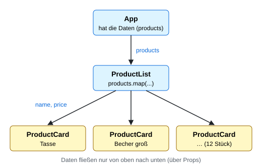

# React-Grundlagen mit Vite: Produktliste

LF10a UW9

Code: `frontend/prototypes/produktliste/` (`npm install`, `npm run dev`, `npm run lint`)

## 1.1 Kopierten Code untersuchen

a) Probleme:
- Eine Änderung (z. B. am Aufbau der Kachel oder an der Preisformatierung) muss an zwölf Stellen gemacht werden.
- Man vergisst leicht eine Stelle, dann sehen die Kacheln unterschiedlich aus oder es gibt Fehler.

b) Die Kachel wird einmal als Komponente `ProductCard` geschrieben. Für jedes Produkt wird dieselbe Komponente nur mit anderen Daten benutzt. Eine Änderung macht man dann nur noch an einer Stelle.

c) Props sind die Werte, die man einer Komponente von außen mitgibt, ähnlich wie Parameter bei einer Funktion. Zum Beispiel `<ProductCard name="Tasse" price={14.5} />`.

## 1.2 Komponentenstruktur planen

| Komponente | Aufgabe | Props |
|---|---|---|
| App | Hauptkomponente, hat die Produktdaten und zeigt Überschrift und Liste | keine |
| ProductList | macht aus dem Array mit `map` eine Liste von Kacheln | `products` |
| ProductCard | zeigt eine Kachel mit Name und Preis | `name`, `price` |

b) Komponentenbaum:

## 1.3 Vite-Projekt und Kachel

a) Projekt mit `npm create vite@latest` (Vorlage React) erstellt und mit `npm run dev` gestartet. Wichtige Ordner: `index.html` (Startseite), `src/main.jsx` (startet React), `src/App.jsx`, `public/` (Dateien wie das Favicon), `package.json`. Die Beispielbilder aus der Vorlage habe ich gelöscht.

b) `ProductCard` bekommt `name` und `price` als Props. `ProductList` macht mit `products.map(...)` aus den 12 Produkten 12 Kacheln, als `key` nehme ich die `id`.

c) Die aktuelle Vite-Vorlage bringt statt ESLint das Tool oxlint mit. Ich habe es entfernt und ESLint eingerichtet (`eslint.config.js`). Der erste Lauf hat 4 Fehler gezeigt: „'ProductList' is defined but never used“ usw. Die Komponenten werden aber im JSX benutzt, das erkennt die Grundregel nicht. Ich habe die Regel so eingestellt, dass Namen mit Großbuchstaben ignoriert werden. Jetzt läuft `npm run lint` ohne Fehler.

## 1.4 Code prüfen

Ich habe alleine gearbeitet und die Prüfliste deshalb auf mein eigenes Projekt angewendet.

| Prüffrage | Bewertung | Kommentar |
|---|---|---|
| Eine Kachel-Komponente, kein kopierter Code | erfüllt | nur `ProductCard`, 12-mal über `map` benutzt |
| Daten kommen über Props | erfüllt | `name` und `price` kommen von `ProductList` |
| Jedes Listenelement hat einen eindeutigen key | erfüllt | `key={product.id}` |
| ESLint ohne Fehler | erfüllt | nach der Korrektur 0 Fehler |

## 1.5 Fazit

a) Props gehören der Elternkomponente. Wenn die Kachel sie selbst ändert, weiß die Elternkomponente nichts davon und React zeichnet nicht neu, dann passen Daten und Anzeige nicht mehr zusammen. Werte, die sich ändern sollen, gehören in den State.

b) Mit einem Befehl hat man ein fertiges Projekt mit Entwicklungsserver, der Änderungen sofort im Browser zeigt. Man muss nichts selbst einrichten.
