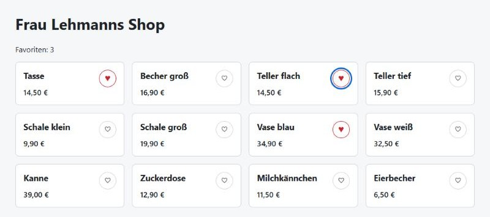

# React: State und Hooks – Favoriten

LF10a UW10

Code: `frontend/prototypes/produktliste/` (baut auf UW9 auf, `npm run dev`)

## 1.1 Warum ist der Favorit weg?

a) `favs` ist eine normale Variable. `push` ändert zwar das Array, aber React bekommt davon nichts mit und zeichnet die Komponente nicht neu. Deshalb bleibt das Herz grau.

b) Die Variable liegt nur im Arbeitsspeicher. Beim Neuladen startet das Programm von vorne und `favs` ist wieder `[]`.

c) Anzeige ändert sich nicht → `useState` (der Setter löst neues Rendern aus). Weg nach Neuladen → mit `useEffect` in `localStorage` speichern und beim Start wieder laden.

## 1.2 State und Effekt planen

| Schritt | Hook | Was passiert? |
|---|---|---|
| Favoriten merken | `useState` | `favs` ist ein Array mit den ids, `setFavs` ändert es und React zeichnet neu |
| Beim Start laden | `useState` mit Startfunktion | `useState(() => JSON.parse(localStorage.getItem('favs') ?? '[]'))` liest einmal beim ersten Rendern |
| Bei Änderung speichern | `useEffect` mit `[favs]` | jedes Mal, wenn sich `favs` ändert, wird das Array in `localStorage` geschrieben |

## 1.3 Favoriten umsetzen

a) Jede Kachel hat einen Herz-Button mit `aria-pressed={isFav}` und `aria-label`, z. B. „Tasse als Favorit“. `toggleFav` gibt immer ein neues Array an `setFavs` (hinzufügen mit `[...prev, id]`, entfernen mit `filter`), nie `push`.

b) Zuerst habe ich das Laden auch mit `useEffect(..., [])` gemacht. ESLint hat gemeldet „Avoid calling setState() directly within an effect“, und beim Test waren die Favoriten nach dem Neuladen trotzdem weg: Der Speicher-Effekt hat beim Start zuerst `[]` gespeichert. Deshalb lade ich jetzt direkt im Startwert von `useState`. Getestet: zwei Herzen angeklickt, Seite neu geladen, beide sind noch rot.

c) Messung: Die React-DevTools-Erweiterung hatte ich im Browser nicht, deshalb habe ich zum Messen kurz einen Zähler in `ProductCard` eingebaut.

| | Kacheln neu gezeichnet pro Klick |
|---|---|
| vorher | alle 12 |
| nachher | 1 (nur die geklickte) |

Ursache: Bei jeder Änderung rendert `App` neu und damit alle Kacheln. Maßnahme: `ProductCard` mit `memo` umschlossen (zeichnet nur neu, wenn sich die Props ändern) und `toggleFav` mit `useCallback`, damit die Funktion nicht bei jedem Rendern neu erstellt wird. (Im Entwicklungsmodus zählt React wegen StrictMode jeden Aufruf doppelt, gemessen 24 und 2.)

## 1.4 Funktion prüfen

Ich habe alleine gearbeitet und die Prüfliste deshalb auf mein eigenes Projekt angewendet.

| Prüffrage | Bewertung | Kommentar |
|---|---|---|
| Klick ändert die Anzeige sofort | erfüllt | Herz wird rot, Zähler „Favoriten“ ändert sich |
| Favoriten bleiben nach Neuladen erhalten | erfüllt | erst nach der Korrektur beim Laden (siehe 1.3 b) |
| Button ist per Tastatur bedienbar und hat aria-pressed | erfüllt | echter `button`, mit Tab erreichbar, Leertaste schaltet um |
| Profiler-Messung ist dokumentiert | erfüllt | siehe 1.3 c |

## 1.5 Fazit

a) Wenn man eine normale Variable ändert, passiert in der Anzeige nichts. Steht sie in der Komponente, ist sie beim nächsten Rendern sogar wieder auf dem Startwert. State merkt sich React zwischen den Renders, und eine Änderung über den Setter zeichnet die Komponente neu.

b) Ein Effekt ist für Sachen außerhalb von React da, z. B. etwas in `localStorage` speichern, Daten laden oder einen Timer starten. Er läuft nach dem Rendern.
