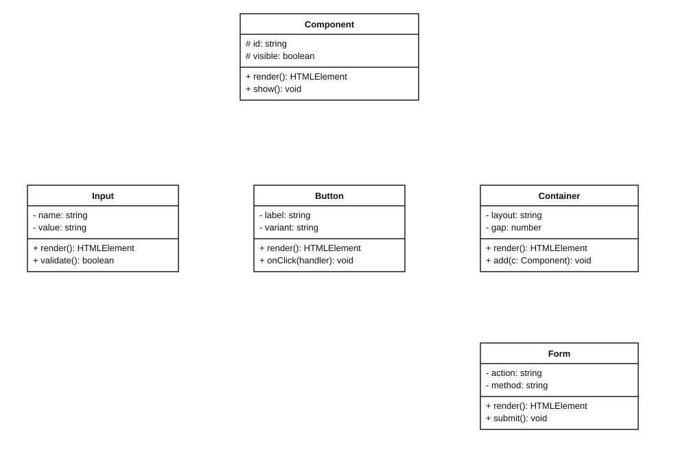

# UML-Klassendiagramm UI-Bibliothek

LF11A UW8

## 1.1 Klassen

Fünf Klassen: Component, Input, Button, Container und Form. Jede hat zwei Attribute und mindestens eine Methode. Sichtbarkeit: + public, - private, # protected.

## 1.2 Beziehungen

- Vererbung: Input, Button und Container erben von Component. Form erbt von Container.
- Komposition: Ein Formular besteht aus mindestens einem Eingabefeld (1 zu 1..*).
- Assoziation: Ein Button schickt ein Formular ab (1 zu 1).

## 1.3 Abstrakte Klasse

Component ist abstrakt. Es gibt keine „Component“ allein, sondern nur Input, Button usw. Ich habe eine abstrakte Klasse und kein Interface genommen, weil Component schon Attribute (id, visible) und eine fertige Methode show() hat.
