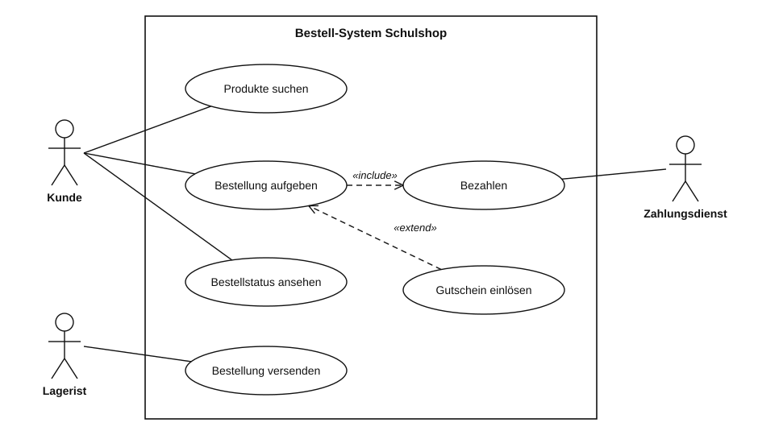

# Use-Case-Diagramm Bestell-System

LF11A UW7

Bestell-System für den Schulshop: Schüler:innen und Lehrkräfte bestellen Hefte, Stifte und Technik.

## 1.1 Akteure

- Primäre Akteure (starten einen Use-Case, weil sie ein Ziel haben): Kunde, Lagerist
- Sekundärer Akteur (wird vom System dazugeholt): Zahlungsdienst

## 1.2 Diagramm

- include: Zu „Bestellung aufgeben“ gehört immer „Bezahlen“.
- extend: „Gutschein einlösen“ kommt nur dazu, wenn der Kunde einen Gutscheincode hat.

## 1.3 Beschreibung: Bestellung aufgeben

**Ziel:** Der Kunde bestellt die Produkte aus seinem Warenkorb.

**Akteure:** Kunde (primär), Zahlungsdienst (sekundär)

**Vorbedingung:** Der Kunde ist angemeldet und hat mindestens ein Produkt im Warenkorb.

**Standardablauf:**

1. Der Kunde öffnet den Warenkorb und klickt auf „Bestellen“.
2. Das System zeigt Produkte, Anzahl und Gesamtpreis.
3. Der Kunde gibt die Lieferadresse ein bzw. bestätigt sie.
4. Der Kunde wählt eine Zahlungsart und bezahlt (Use-Case „Bezahlen“ mit dem Zahlungsdienst).
5. Das System speichert die Bestellung und zeigt eine Bestätigung mit Bestellnummer.

**Nachbedingung:** Die Bestellung ist gespeichert und bezahlt, der Lagerist sieht sie in seiner Liste, der Warenkorb ist leer.

## 1.4 Reflexion

(1) include nimmt man, wenn ein Schritt immer dazugehört (Bestellen ohne Bezahlen geht nicht). extend nimmt man für etwas, das nur manchmal passiert, unter einer Bedingung (Gutschein nur, wenn man einen hat).

(2) Ein Use-Case beschreibt ein Ziel aus Sicht des Nutzers, zum Beispiel „Anmelden“. Wie das Passwort gespeichert wird, merkt der Nutzer gar nicht. Das ist ein technischer Schritt und gehört in die Planung des Programms, nicht ins Use-Case-Diagramm.
