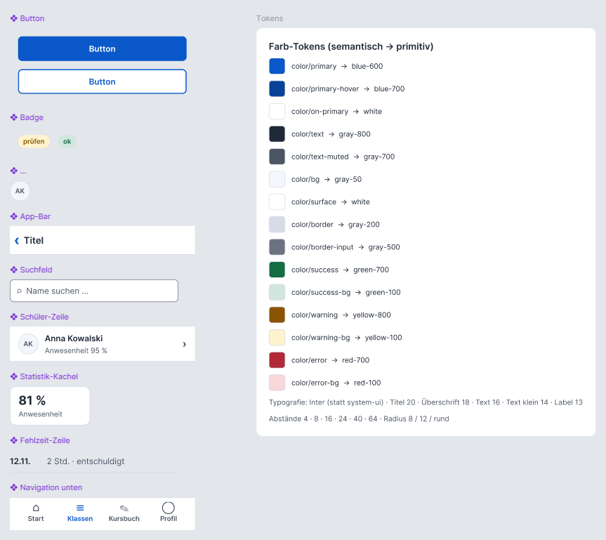
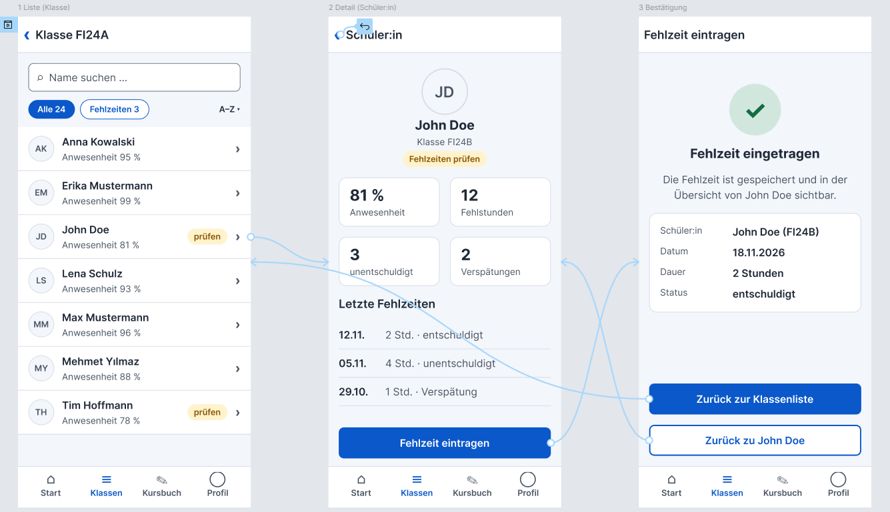

# Hi-Fi-Prototyp Classroom-Manager App

LF11A UW6 – High-Fidelity-Prototypen

Aus meinen Wireframes (UW5) habe ich in Figma einen klickbaren Hi-Fi-Prototyp gebaut. Flow: **Liste (Klasse) → Detail (Schüler:in) → Bestätigung**.

Figma-Datei: https://www.figma.com/design/JTPDfOyMmNubWFJOz3YG8M/Classroom-Manager-Hi-Fi-Prototyp

## 1.1 Hi-Fi-Screens mit Tokens und Komponenten

**Tokens:** Die Werte kommen aus meiner `tokens.css` (UW4). In Figma sind sie als Variablen angelegt:

- „Primitive Tokens“: die Farbpalette, z. B. `blue/600 = #0a58ca`
- „Semantische Tokens“: verweisen auf die primitiven, z. B. `color/primary → blue-600`
- „Abstände & Radien“: 4, 8, 16, 24, 40, 64 px und Radius 8 / 12

Alle Farben in den Komponenten sind an semantische Variablen gebunden, nicht als Hex-Wert eingetragen.

**Typografie:** Figma kennt `system-ui` nicht, deshalb habe ich Inter genommen. Textstile: Titel 20, Überschrift 18, Text 16, Text klein 14, Label 13 (wie die Font-Size-Tokens).

**Komponenten:** Button (Varianten Primär/Sekundär), Badge (Warnung/Erfolg), Avatar, App-Bar, Suchfeld, Schüler-Zeile, Statistik-Kachel, Fehlzeit-Zeile, Navigation unten. Die Komponenten haben Eigenschaften, z. B. Name und Info bei der Schüler-Zeile oder „Zurück“ (an/aus) bei der App-Bar. Die Screens bestehen nur aus Instanzen, nichts ist kopiert. Die Liste hat zum Beispiel 7 Instanzen der Schüler-Zeile.

Änderungen gegenüber dem Wireframe:

- Der Start-Screen ist nicht dabei, weil der Flow mit der Liste beginnt. Dafür gibt es den neuen Screen „Bestätigung“.
- „prüfen“ ist jetzt ein gelbes Badge (Warning-Token), damit man es in der Liste sofort sieht.
- Die aktive Seite in der Navigation ist blau statt dunkelgrau.

## 1.2 Klickbarer Flow

| Nr. | Von | Klick auf | Nach | Transition |
|---|---|---|---|---|
| 1 | Liste | Zeile „John Doe“ | Detail | Move in von rechts, 300 ms |
| 2 | Detail | Button „Fehlzeit eintragen“ | Bestätigung | Smart Animate, 400 ms |
| 3 | Bestätigung | Button „Zurück zur Klassenliste“ | Liste | Move in von links, 300 ms |

Zusätzlich: „‹“ in der Detail-Ansicht geht einen Schritt zurück, „Zurück zu John Doe“ öffnet wieder die Detail-Ansicht. Startpunkt des Flows ist die Liste.

## 1.4 Reflexion

**Warum genügen oft schon wenige Testpersonen?**
Die meisten Probleme stören fast alle Nutzer:innen gleich. Schon nach 3–5 Personen sieht man immer wieder dieselben Fehler, neue kommen kaum dazu (nach Jakob Nielsen findet man mit 5 Personen etwa 85 % der Probleme). Besser als ein großer Test sind mehrere kleine Tests: Fehler beheben und danach wieder mit wenigen Personen testen.
