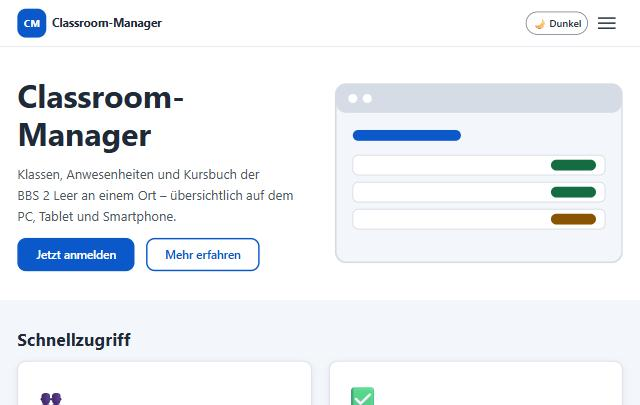
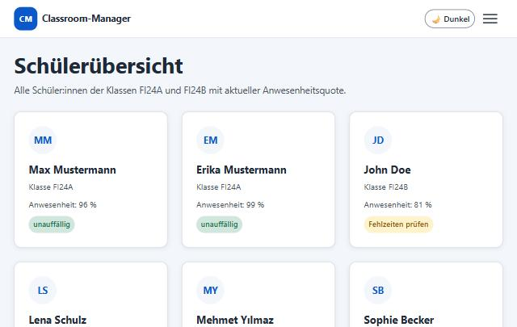
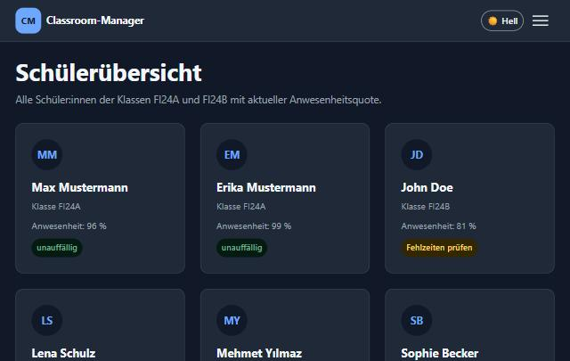
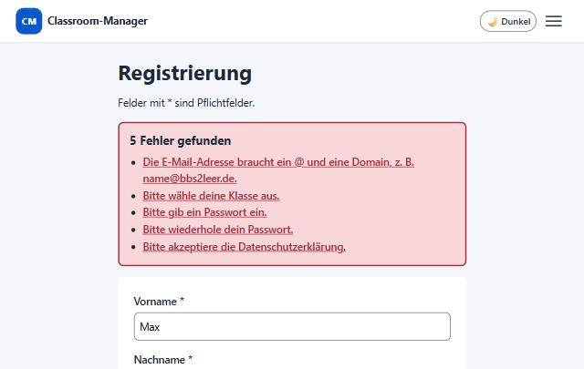
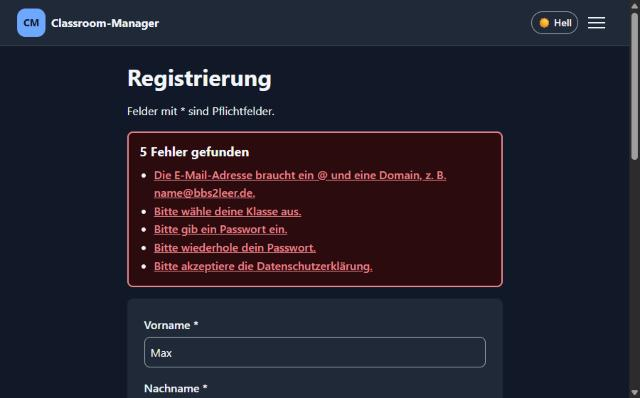

# Style-Guide Classroom-Manager

LF11A UW4 – Design-Systeme & Design-Tokens

Der Kunde will, dass alle Web-Applikationen gleich aussehen. Deshalb binden alle Seiten (Landing-Page, Schülerübersicht, Registrierung) dieselben zwei Dateien ein:

- `tokens.css` – alle Farben, Schriftgrößen und Abstände als Tokens
- `common.css` – was überall gleich ist: Grundeinstellungen, Fokus, Buttons, Header, Footer

Jede Seite hat danach nur noch eigene Dateien für ihr Layout und ihre Bausteine. Soll sich am Design etwas ändern, ändert man es einmal in `tokens.css` und alle Seiten übernehmen es.

## 1.1 Design-Tokens

### Farben

| Token | Hell | Dunkel | Wofür |
|---|---|---|---|
| `--color-primary` | `#0a58ca` | `#6ea8fe` | Buttons, Links, Logo |
| `--color-text` | `#1f2937` | `#f3f6fb` | Text |
| `--color-text-muted` | `#4b5563` | `#9ca3af` | Nebentext, Hinweise |
| `--color-bg` | `#f3f6fb` | `#111827` | Seitenhintergrund |
| `--color-surface` | `#ffffff` | `#1f2937` | Header, Footer, Karten, Formular |
| `--color-border` | `#d6dce5` | `#374151` | Trennlinien |
| `--color-border-input` | `#6b7280` | `#9ca3af` | Rahmen von Feldern |
| `--color-success` | `#146c43` | `#75b798` | Status „unauffällig“ |
| `--color-warning` | `#8a5300` | `#ffda6a` | Status „Fehlzeiten prüfen“ |
| `--color-error` | `#b02a37` | `#ea868f` | Fehlermeldungen |

Dazu kommen `--color-primary-hover`, `--color-on-primary` (Text auf dem Button), `--color-focus` und für success, warning und error je eine Hintergrundfarbe (`-bg`).

### Schrift und Abstände

- Schriftgrößen: `--font-size-xs` bis `--font-size-xl` (13 bis 20px)
- Abstände: `--space-xs` bis `--space-xxl` (4, 8, 16, 24, 40, 64px)
- Sonstiges: `--radius-s`, `--radius-m`, `--radius-full` für runde Ecken, `--focus-width` und `--focus-offset` für die Fokus-Linie

### Benennung

- Aufbau `--kategorie-bedeutung`, z. B. `--color-error` oder `--space-m`. Vorne steht die Kategorie, so findet man alles schnell.
- Nach Bedeutung, nicht nach Farbe: `--color-primary` statt `--blau`. Wenn sich die Farbe ändert, passt der Name trotzdem.
- Größen wie bei Kleidung: `xs, s, m, l, xl`.

## 1.2 Anwendung

In den CSS-Dateien stehen keine festen Farben mehr, nur Tokens. Beispiel Button aus `common.css`:

```
.button--primary {
  background: var(--color-primary);
  color: var(--color-on-primary);
}
```

Benutzt werden die Tokens u. a. für Buttons, Header mit Navigation, Footer, Karten, Badges, Eingabefelder und Fehlermeldungen.

## 1.3 Dunkles Theme

Oben rechts auf jeder Seite ist ein Button „🌙 Dunkel“ bzw. „☀️ Hell“. Er setzt `data-theme="dark"` an `<html>` (`theme.js`). In `tokens.css` bekommen die Farb-Tokens dann andere Werte, die Komponenten bleiben gleich. Die Auswahl wird gespeichert und gilt auf allen Seiten. Der Kontrast ist in beiden Themes mindestens 4,5 : 1.








## 1.4 Reflexion

**(1) Primitives und semantisches Token**
Ein primitives Token ist nur ein Wert aus der Farbpalette, z. B. `--blue-600: #0a58ca`. Ein semantisches Token sagt, wofür etwas benutzt wird, z. B. `--color-primary`, und zeigt auf ein primitives Token: `--color-primary: var(--blue-600)`. Die Komponenten benutzen nur semantische Tokens. Deshalb mussten wir für das dunkle Theme nur die Verweise ändern.

**(2) Vorteil beim Rebranding**
Eine neue Firmenfarbe ändert man nur einmal in `tokens.css`. Alle Web-Applikationen, die diese Datei einbinden, haben sofort die neue Farbe. Man muss nicht jede Datei durchsuchen und vergisst keine Stelle.
