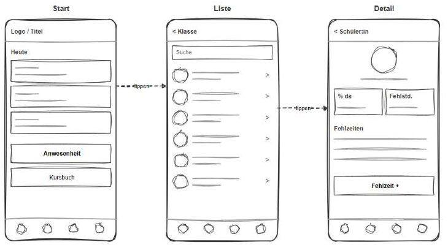
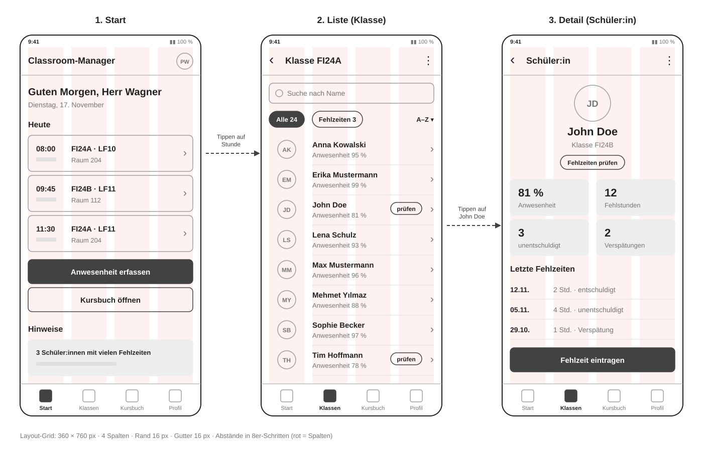

# Wireframes Classroom-Manager App

LF11A UW5 – Wireframes & Low-Fidelity-Prototypen

Erstes UI-Konzept für eine Mobile-App für Lehrkräfte (Persona Paul Wagner). Drei zusammenhängende Screens: **Start → Liste (Klasse) → Detail (Schüler:in)**.

## 1.1 Skizze

Statt auf Papier habe ich die Skizze in draw.io gemacht (Datei: `docs/wireframes/uw5-skizze.drawio`). Nur Kästen und Striche statt Text, keine Farben.

Informationshierarchie: Was ist am wichtigsten, steht oben und ist groß.

| Screen | Zuerst (wichtigste Info) | Danach | Hauptaktion |
|---|---|---|---|
| Start | heutige Stunden mit Uhrzeit und Klasse | Hinweis auf Schüler:innen mit vielen Fehlzeiten | „Anwesenheit erfassen“ |
| Liste | Name und Anwesenheit jeder Person | Suche, Filter „Fehlzeiten“, Sortierung | Tippen auf eine Person |
| Detail | Name, Klasse, Status „Fehlzeiten prüfen“ | Zahlen (Anwesenheit, Fehlstunden …), letzte Fehlzeiten | „Fehlzeit eintragen“ |

## 1.2 Digitale Wireframes mit Layout-Grid

Layout-Grid (rote Spalten im Bild):

- Screen 360 × 760 px (typisches Smartphone)
- 4 Spalten, 16 px Rand links/rechts, 16 px Abstand zwischen den Spalten (Gutter)
- alle Abstände und Höhen in 8er-Schritten (8, 16, 24, 48 px …)

Beispiele: In der Liste stehen die Initialen in Spalte 1 und die Namen beginnen genau an Spalte 2. Auf der Detailseite sind die Zahlen-Kacheln je 2 Spalten breit. Die Navigation unten hat 4 Punkte, einen pro Spalte.

Bewusst nur Grautöne, Platzhalter statt Bilder, keine echten Icons.

## 1.4 Reflexion

**Warum ohne finale Farben und Bilder?**
Ein Wireframe soll nur Struktur zeigen: Was steht wo, was ist wichtig, wie kommt man von Screen zu Screen. Mit Farben und Bildern reden alle über Geschmack („das Blau gefällt mir nicht“) statt über den Aufbau. Außerdem ist eine Skizze schnell geändert, und Testpersonen trauen sich eher, etwas Unfertiges zu kritisieren.
